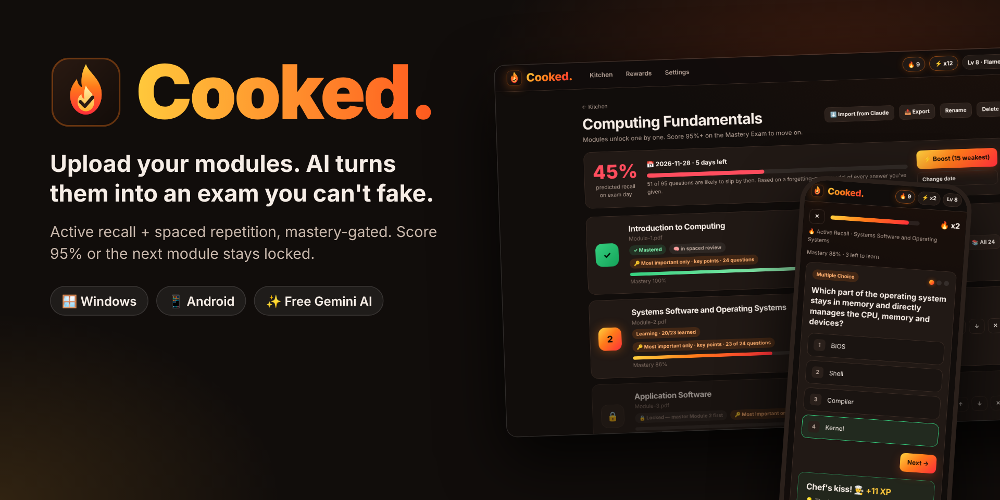
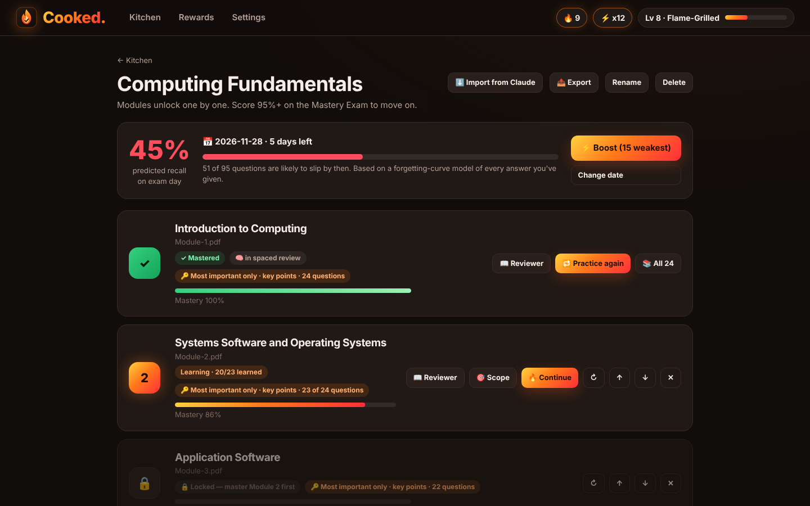
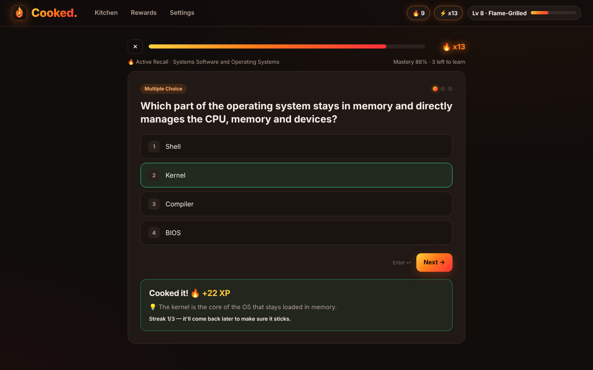
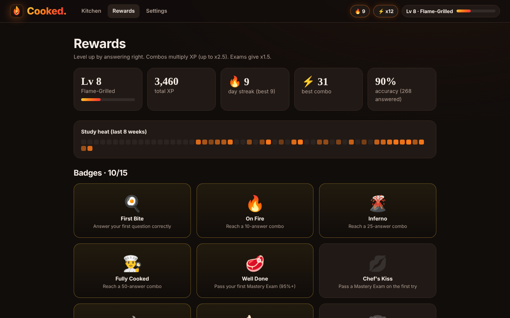
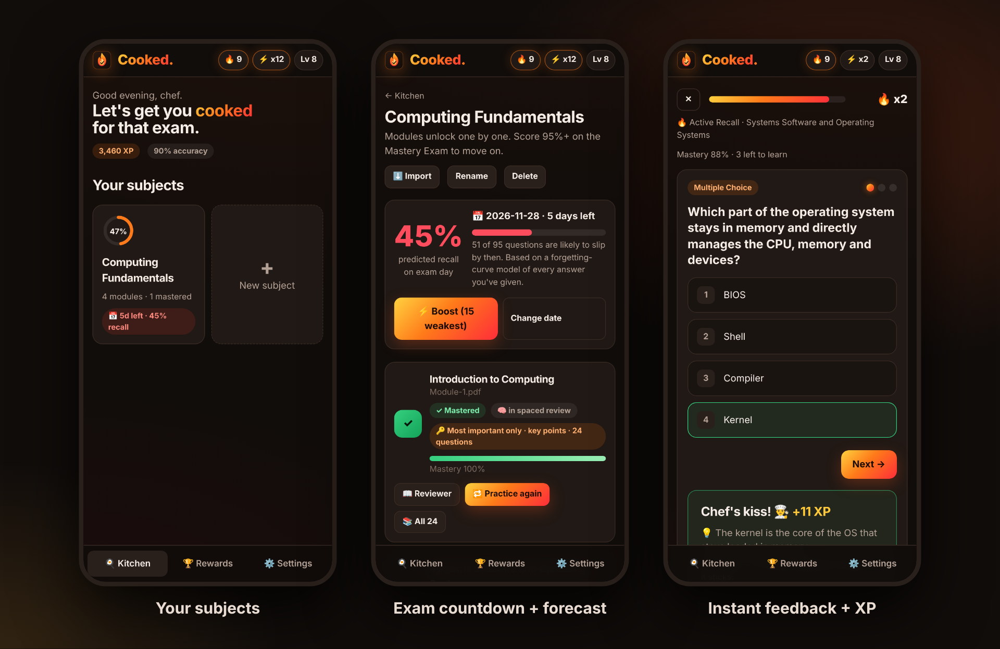

<div align="center">



# Cooked.

### Active recall that gets you exam-ready.

**Upload your modules → AI reads every page and diagram → it quizzes you until you actually know it → 95% on the Mastery Exam or the next module stays locked.**
Free. No ads. Your notes and progress stay on your device.

[](https://github.com/dav-voidd/cooked/releases/latest)
[](https://github.com/dav-voidd/cooked/releases)
[](https://github.com/dav-voidd/cooked/actions)


### [⬇️ Download for Windows & Android](https://github.com/dav-voidd/cooked/releases/latest)

</div>

---

## ✨ What it does

| | |
|---|---|
| 📄 **Scans your modules** | PDF, PPTX, DOCX, images or text. AI reads every page *and diagram* and writes a reviewer + question bank |
| 🧠 **6 question types** | Multiple choice, true/false, identification, fill in the blank, enumeration, essay (AI-graded) |
| 🔒 **Mastery gating** | Modules unlock one by one: 3 correct in a row per question, then a **Mastery Exam at 95%+** |
| 🔑 **Key points mode** | Learn just the main term and idea of each topic, or pick exactly what your prof covered with **🎯 Scope** |
| 📅 **Exam countdown** | A forgetting-curve model predicts your recall on exam day and times reviews to peak then |
| ⚡ **Boost** | Drills your 15 weakest questions until they stick |
| 🏆 **Rewards** | XP, combos, ranks (Raw → Legendary Chef), daily streaks, 15 badges |
| ⏸️ **Resume anywhere** | Switch tabs or close the app and pick up on the same question |
| ✈️ **Works offline** | Scan once, study anywhere. Only scanning and essay grading need internet |

Built on the two study methods with the strongest research behind them: **practice testing** and **spaced practice** (Dunlosky et al., 2013), combined as *successive relearning*.

## 🖼️ Preview

<div align="center">

**💻 Windows**



 

**📱 Android**



</div>

## 🚀 Quick start

| Platform | Download | Install |
|---|---|---|
| 🪟 Windows | **[Cooked.exe](https://github.com/dav-voidd/cooked/releases/latest)** | Double-click. If Windows says *"protected your PC"*: **More info → Run anyway** |
| 📱 Android | **[Cooked.apk](https://github.com/dav-voidd/cooked/releases/latest)** | Open it on your phone. Allow *"Install unknown apps"* if asked |

Then:
1. 🔑 **Settings** → paste a free Gemini key from [AI Studio](https://aistudio.google.com/apikey) (no card needed).
2. ➕ **New subject** → upload your modules in order.
3. 🔥 Hit **Start** and get cooked.

**Run from code:**
```bash
git clone https://github.com/dav-voidd/cooked.git
cd cooked/desktop
python app.py        # no extra installs needed
```

## ❓ FAQ

<details>
<summary>Is it free?</summary>

Yes. No ads, no account. The Gemini key is free too.
</details>

<details>
<summary>Can I use my Claude Pro instead of Gemini?</summary>

On the Windows app, yes: **Settings → Claude Pro → Connect** (needs Claude Code installed and signed in).
</details>

<details>
<summary>Can I study on my phone what I scanned on my PC?</summary>

Yes. On PC open the subject → **📤 Export**. On the phone open the subject → **⬇️ Import**.
</details>

<details>
<summary>Why 95%?</summary>

So you can't pass by luck. 94% or lower is a fail. Missed questions come back until you know them.
</details>

<details>
<summary>Where is my data?</summary>

Only on your device. On Windows it's in `%LOCALAPPDATA%\Cooked`. Only the module you scan is sent to the AI.
</details>

## 🧱 Built with

Python (stdlib) · [pywebview](https://pywebview.flowrl.com) · [Capacitor](https://capacitorjs.com) · [pdf.js](https://mozilla.github.io/pdf.js/) · [JSZip](https://stuk.github.io/jszip/) · [Gemini API](https://ai.google.dev)

<details>
<summary>📁 Project structure</summary>

```
desktop/                 Windows app (Python stdlib + web UI)
├── app.py               window, local server, shortcuts
├── engine.py            grading, mastery gating, forgetting-curve scheduler, rewards
├── gemini.py · claude_cli.py · extract.py
└── static/              UI (index.html, app.js, style.css)
mobile/                  Android app (Capacitor)
└── www/js/engine.js     the same engine, running on the phone
.github/workflows/       builds Cooked.exe + Cooked.apk on every push
```
</details>

---

<div align="center">

Made with 🔥 by [dav](https://github.com/dav-voidd) · [MIT License](LICENSE)

</div>
